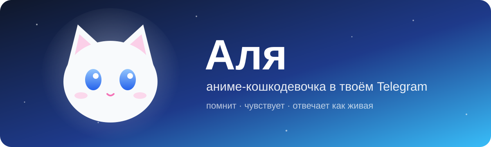
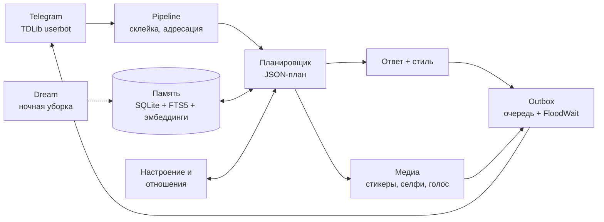

<div align="center">



<h3>Telegram-компаньон с памятью, настроением и характером</h3>

<p>
Живёт в собственном аккаунте (userbot), помнит людей и разговоры, понимает, когда в группе<br>
обращаются к ней без реплая, и пишет по-русски короткими сообщениями, как живая.
</p>

<p>
<a href="https://github.com/pizdalic/alya-v3/actions/workflows/ci.yml"></a>


<a href="LICENSE"></a>
</p>

<p>
<a href="#-возможности">Возможности</a> •
<a href="#-быстрый-старт">Быстрый старт</a> •
<a href="#-как-это-устроено">Архитектура</a> •
<a href="#-команды">Команды</a> •
<a href="#-документация">Документация</a>
</p>

</div>

---

## 🐾 Кто такая Аля

Аниме-девушка-кошка 19 лет: длинные белые волосы, синие глаза, кошачьи ушки и хвостик. Студентка из Екатеринбурга, любит аниме, мангу, игры и музыку в наушниках.

| Характер | Какая она |
|---|---|
| `shy` *(по умолчанию)* | стеснительная и мягкая |
| `tsundere` | цундере: снаружи колючая, внутри добрая |

Характер переключается в конфиге: `[character] persona = "tsundere"` или `ALYA_CHARACTER__PERSONA=tsundere`. Файлы персонажа лежат в [`character/`](character/).

> [!NOTE]
> **Честность.** На шутливый вопрос «ты бот?» Аля может отшутиться, но на серьёзный и прямой вопрос всегда признаёт, что она ИИ-персонаж (это не настраивается). Флирт — только с владельцем, с остальными она дружелюбна; 18+ нет.

## ✨ Возможности

<table>
<tr>
<td width="50%" valign="top">

### 🧠 Память
- изоляция: личка / чат / персонаж
- уровни с TTL, поиск FTS5 + эмбеддинги + RRF
- Forget API и Markdown-зеркало памяти
- **Dream**: ночью сливает дубли, помечает противоречия, понижает уверенность в старом

</td>
<td width="50%" valign="top">

### 💗 Характер
- настроение VAD с плавным затуханием и дневником
- отношение к каждому собеседнику
- двухэтапная генерация: план в JSON → ответ
- стиль: строчные, короткие сообщения, редкие эмодзи и опечатки
- защита от подмены промпта

</td>
</tr>
<tr>
<td width="50%" valign="top">

### 💬 Telegram
- userbot на TDLib, запасной режим через Bot API
- склеивает быстрые сообщения
- понимает, когда в группе отвечают ей без реплая
- не лезет в чужие разговоры
- очередь отправки с учётом FloodWait

</td>
<td width="50%" valign="top">

### 🎨 Медиа
- смотрит фото, слушает голосовые и кружки
- иногда отвечает голосом
- реакции и стикеры из разрешённых наборов
- «селфи» в аниме-стиле (только в личке)
- поиск свежих фактов в интернете

</td>
</tr>
<tr>
<td width="50%" valign="top">

### 🌙 Автономия
- иногда пишет первой в личку (не ночью, не чаще раза в сутки, `/pause` отключает)
- сама вступает в разговор о своих интересах
- напоминает о том, о чём попросили
- читает каналы, на которые подписана

</td>
<td width="50%" valign="top">

### 🛡️ Надёжность и приватность
- бэкапы с ротацией и восстановлением без воскрешения забытого
- `/privacy`, `/mydata`, `/export`, `/forget`, `/forget_me` для любого собеседника
- модерация (dry_run), плагины с разрешениями
- логи без секретов, healthcheck, аудит безопасности

</td>
</tr>
</table>

## 🚀 Быстрый старт

**Ubuntu + Docker**

```bash
cp config.example.toml config.toml
cp .env.example .env          # заполнить секреты
mkdir -p runtime && sudo chown 10001:10001 runtime
docker compose build
docker compose run --rm alya check-config
docker compose up -d
docker compose exec alya alya healthcheck
```

**Вход в Telegram** — один раз на сервере, интерактивно (код из Telegram и пароль 2FA вводятся вручную и не сохраняются):

```bash
docker compose run --rm -it alya login
```

Сессия хранится в `./runtime/td_database`. После входа: `docker compose up -d`.

**Обновление**

```bash
git pull && docker compose build && docker compose up -d
```

<details>
<summary><b>🛠️ Локальная разработка</b></summary>

```bash
python3 -m venv .venv && . .venv/bin/activate
pip install -e ".[dev]"
alya check-config
alya migrate
pytest -q && ruff check . && mypy
```

`alya chat` — поговорить с Алей прямо в терминале (как владелец, в личке), без Telegram. Нужны `llm.api_key` и `[llm.roles.chat]`; `[llm.roles.utility]` (если задана) используется для планирования ответа.

</details>

## ⚙️ Настройка

Конфигурация: `config.toml` + переменные окружения `ALYA_<СЕКЦИЯ>__<КЛЮЧ>` (окружение важнее файла).

> [!IMPORTANT]
> Секреты (`api_hash`, `api_key`, `bot_token`) принимаются только из окружения.

| Секция | За что отвечает |
|---|---|
| `[llm.roles.chat]`, `[llm.roles.utility]` | ответы и планирование |
| `[llm.roles.vision]`, `stt`, `tts`, `image` | фото, распознавание речи, голос, селфи (тот же API-ключ) |
| `[media]` | выключатели и лимиты в час/сутки |
| `[character]` | характер (`shy` / `tsundere`) |
| `[dream]` | ночная уборка памяти (после 04:00 по Екатеринбургу; вручную — `alya dream`) |
| `[plugins]` | плагины, пример — [`examples/plugins/dice.py`](examples/plugins/dice.py) |

Для голоса нужен ffmpeg (в Docker-образе уже есть). Если лимит исчерпан или модель не ответила, Аля просто пишет текстом и не делает вид, что отправила файл.

## 🧩 Как это устроено



Подробнее — в [docs/ARCHITECTURE.md](docs/ARCHITECTURE.md).

## 🎮 Команды

<details open>
<summary><b>Владелец в Telegram</b> (только в личке с Алей; от других людей — обычный текст)</summary>

| Команда | Что делает |
|---|---|
| `/join <ссылка>` | вступить в чат по пригласительной ссылке |
| `/bio <текст>` | сменить описание профиля (до 70 символов) |
| `/avatar` | подпись к прикреплённому фото: сделать его аватаром |
| `/stickers add\|remove <набор>` | разрешённые наборы стикеров (имя или `t.me/addstickers/…`) |
| `/stickers list` | список наборов |
| `/media` | что включено и сколько потрачено за сутки |
| `/help` | список команд |

</details>

<details>
<summary><b>Любой собеседник</b></summary>

`/privacy`, `/mydata`, `/export`, `/forget`, `/forget_me`, `/pause`

</details>

<details>
<summary><b>CLI</b></summary>

`alya check-config`, `alya migrate`, `alya run`, `alya chat`, `alya persona`, `alya dream`, `alya login`, `alya backup`, `alya backups`, `alya restore <файл> --yes`, `alya export-user <id>`, `alya healthcheck`, `alya version`

</details>

## 🗺️ Статус

- [x] **Phase 0–2** — основа: конфигурация, DI, Event Bus, SQLite с миграциями, логирование, Docker, CI
- [x] **Phase 3** — память
- [x] **Phase 4** — персонаж, настроение, стиль
- [x] **Phase 5** — Telegram userbot
- [x] **Phase 6** — мультимодальность
- [x] **Phase 7** — автономия
- [x] **Phase 8** — укрепление и релиз

План целиком — [docs/IMPLEMENTATION_PLAN.md](docs/IMPLEMENTATION_PLAN.md).

## 📚 Документация

| | |
|---|---|
| 🏗️ [ARCHITECTURE](docs/ARCHITECTURE.md) | архитектура |
| 🧭 [DECISIONS](docs/DECISIONS.md) · [ADR](docs/ADR/) | принятые решения |
| 🔐 [SECURITY](docs/SECURITY.md) | модель угроз |
| 📦 [DEPENDENCIES](docs/DEPENDENCIES.md) | зависимости |
| 📋 [IMPLEMENTATION_PLAN](docs/IMPLEMENTATION_PLAN.md) | план |
| 🚀 [OPERATIONS](docs/OPERATIONS.md) | установка, бэкапы, обновление и откат, режим бота |

## 📜 Лицензия

[PolyForm Noncommercial 1.0.0](LICENSE): можно использовать, копировать и изменять в некоммерческих целях; продавать и использовать коммерчески нельзя. См. [ADR-0006](docs/ADR/0006-license.md).

<div align="center">
<sub>сделано с 💙 и кошачьими ушками</sub>
</div>
