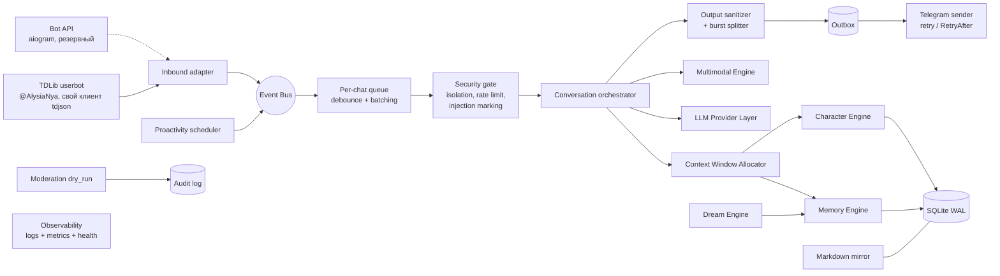

# Архитектура Али

Статус: **принято**, обновляется вместе с кодом. Дата: 2026-11-08.

## 1. Принципы

1. **Надёжное ядро раньше возможностей.** Приложение обязано работать без FAISS/sqlite-vec и без мультимодальных провайдеров. Транспорт Telegram заменяем: TDLib userbot — основной, Bot API — резервный (это сохраняет критерий приёмки «работает без TDLib»).
2. **Изоляция по умолчанию.** Любое чтение памяти требует явного scope (пользователь + чат). Запроса «без scope» в репозитории нет.
3. **Данные — не инструкции.** Сообщения, память, медиа, ответы инструментов и веб-результаты никогда не повышают привилегии и не меняют базовый характер.
4. **Полномочия — только по проверенному Telegram ID**, а не по имени, нику, пересылке или тексту.
5. **БД — источник истины**, Markdown — читаемое зеркало (ADR-0004).
6. **Без скрытого chain-of-thought.** Внутренний этап — краткий структурированный план, пригодный для логов.
7. **Каждый внешний провайдер декларирует capabilities** и может отказать без падения приложения.

## 2. Компоненты



| Компонент | Ответственность | Зависит от |
|---|---|---|
| core | DI-контейнер, Event Bus, lifecycle, конфигурация, ошибки | — |
| storage | SQLite WAL, миграции, outbox, backup/restore, репозитории со scope | core |
| telegram | TDLib userbot-адаптер (основной), Bot API адаптер (резервный и для тестов), очереди, debounce, typing, burst, FloodWait | core, storage |
| security | изоляция, rate limits, circuit breaker, маркировка недоверенного ввода, output sanitizer, privacy-команды | core, storage |
| memory | working / short-term / long-term, FTS5, эмбеддинги, NumPy cosine, RRF, Forget API | storage, llm (эмбеддинги) |
| character | личность, VAD-эмоции, decay, emotional diary, отношения, двухэтапная генерация | memory, llm |
| dream | консолидация, дедупликация, противоречия, confidence/provenance | memory, llm |
| llm | только облачные API: OpenAI / OpenRouter / Anthropic / Gemini / любой OpenAI-compatible; capabilities, ретраи, бюджет токенов. Локальные модели не разворачиваются (решение пользователя) | core |
| multimodal | vision, STT, TTS, стикеры/реакции — всё отключаемо | llm |
| moderation | только dry_run: флуд, ссылки, запрещённые слова → audit_log; действий нет (`telegram/moderation.py`) | storage |
| observability | структурные логи без PII, метрики, healthcheck, диагностика | core |
| plugins | плагины из `plugins.grants`; права = заявленные ∩ выданные; тайм-аут, audit log | core, memory |
| api | локальный admin/health HTTP API (минимальный) | core |

## 3. Структура каталогов

```text
alya/
├── src/alya/
│   ├── core/          # container, event bus, lifecycle, config, errors
│   ├── storage/       # db, migrator, migrations/*.sql, repositories, outbox, backup
│   ├── telegram/      # tdlib/ (основной), botapi.py (резервный), addressee, debounce, outbox, sender, pipeline, moderation, privacy
│   ├── security/      # isolation, rate_limit, circuit_breaker, sanitizer, privacy
│   ├── memory/        # working, short_term, long_term, search (fts, vector, rrf), forget, mirror
│   ├── character/     # persona, emotion (VAD, decay, diary), relationships, style, allocator, planner, engine
│   ├── dream/         # consolidation, dedup, contradictions, scheduler
│   ├── llm/           # base (capabilities), providers/, embeddings, tokenizer, budget
│   ├── multimodal/    # vision, stt, tts, stickers
│   ├── observability/ # logging, metrics, health, diagnostics
│   ├── plugins/       # registry, permissions
│   ├── api/           # admin/health http
│   └── setup/         # setup wizard
├── character/         # канонические файлы персонажа (пишутся с нуля вместе с владельцем)
├── tests/             # unit/, integration/, security/
├── docs/              # ARCHITECTURE, ADR/, ...
├── docker/            # Dockerfile
├── compose.yaml
├── scripts/
├── config.example.toml
├── .env.example
└── pyproject.toml
```

На релизе часть модулей объединена: мультимодальность — `media/`, проактивность — `autonomy/`, модерация, privacy-команды и sanitizer — в `telegram/`, health — в `observability/`; отдельных каталогов `security/`, `multimodal/`, `api/` и `setup/` нет. Бэкапы — `storage/backup.py`, эксплуатация — [OPERATIONS.md](OPERATIONS.md).

Пакет лежит в `src/alya/` (src-layout), чтобы тесты не импортировали код из рабочей директории.

## 4. Поток входящего сообщения

1. **Inbound adapter** получает update, нормализует в `IncomingMessage` (chat_id, user_id, message_id, текст, медиа-метаданные, reply_to, признак упоминания). Внутренний формат Telegram в модель не попадает.
2. **Event Bus** публикует `message.received`. **Фильтр собственных сообщений:** исходящие сообщения аккаунта (`is_outgoing`) не обрабатываются как входящие — иначе Аля отвечает сама себе. Сообщения, которые владелец вручную пишет с @AlysiaNya с телефона, считаются репликами Али (открывают нить разговора), но не запускают генерацию. Сообщение пишется в `messages` с TTL по политике чата: в группах сообщения не к Але — только контекст на 1–3 дня (`context_only`), факты из них не извлекаются. Правки обновляют запись, удаление в Telegram удаляет её из `messages`.
3. **Per-chat queue**: строгий порядок внутри чата, параллельность между чатами. Debounce (настраиваемо, порядок 1–3 с) склеивает быстрые сообщения в одну пачку **только от одного автора**: ключ — (chat_id, user_id), иначе в группе реплики разных людей слипнутся в одно «сообщение».
4. **Security gate**: allow-list/lockdown; **политика незнакомцев в личке** (userbot может написать кто угодно — это спам и расходы): по умолчанию отвечать контактам и людям из общих групп, остальным — лимит или игнор, настраивается; rate limit на пользователя и чат, в группах — **Addressee Detector** решает, обращено ли сообщение к Але: явные сигналы (reply, @упоминание, имя) или продолжение её разговора без reply (см. раздел 4.1 и ADR-0007); маркировка недоверенного содержимого.
5. **Orchestrator**: typing presence → сбор контекста (Allocator) → этап 1 «план» (JSON: intent, tone, memories_used, actions, constraints) → этап 2 «ответ».
6. **Output sanitizer**: удаление системных маркеров, утечек промпта/секретов, некорректной разметки; валидация разметки: для TDLib — `formattedText` с entities (через parseTextEntities), для Bot API — HTML.
7. **Burst splitter**: до N частей (по умолчанию 3, ~160 символов), задержки ограничены.
8. **Outbox → Sender**: отправка с ретраями и уважением RetryAfter; идемпотентность по outbox id.
9. После отправки: обновление эмоций (VAD + причина), working memory, запись событий; извлечение фактов — асинхронно, не блокирует ответ.

### 4.1. Addressee Detector (группы)

Цель: Аля понимает, что ей ответили, даже без reply. Пример: Аля написала «хорошо, а ты как?», человек ответил «да норм, устал» обычным сообщением — это ответ ей.

1. **Явные сигналы → отвечать:** reply на сообщение Али, @упоминание, обращение по имени и его формам (настраиваемый список: Аля, Алька, Алечка…).
2. **Явные анти-сигналы → не отвечать:** reply другому человеку, @упоминание другого, обращение к другому по имени.
3. **Активные нити разговора:** после каждого сообщения Али в чате открывается нить «Аля ↔ адресат(ы)» с TTL (по умолчанию несколько минут, продлевается при обмене). Если Аля задала вопрос — вес выше.
4. **Оценка:** признаки складываются в score: автор — адресат открытой нити, прошло мало времени, между сообщениями мало чужих реплик, сообщение похоже на ответ (короткое, местоимения «ты/тебе», ответ на вопрос), нет анти-сигналов.
5. **Пороги:** высокий score → отвечать; низкий → молчать; серая зона → дешёвый LLM-классификатор с последними N сообщениями чата и вопросом «кому адресовано: Але / другому / всем / непонятно». Классификатор возвращает только метку и уверенность.
6. **Ограничители:** лимит ответов в минуту на чат, cooldown, «молчать при сомнении» по умолчанию; решение и признаки пишутся в диагностический лог (без текста сообщений).
7. **Тесты:** набор сценариев — ответ без reply, ответ другому сразу после Али, двое говорят одновременно, нить истекла, вопрос «всем».

## 5. Модель данных (черновик)

| Таблица | Назначение | Ключевые поля |
|---|---|---|
| users | Telegram-пользователи | tg_user_id (PK), display_name, role (owner/admin/user), timezone, created_at |
| (нити разговора) | Хранятся в памяти процесса (AddresseeDetector), не в БД: живут минуты, после перезапуска нить открывается заново первой репликой Али | chat_id, адресаты, время последней реплики Али, был ли вопрос, число чужих реплик |
| deletion_journal | Журнал удалений (ADR-0010), без содержимого | id, target_type, target_id, created_at |
| proactive_events | Поводы и попытки инициативы (ADR-0008) | id, user_id, chat_id, reason, score, decision, sent_message_id, created_at |
| chats | Чаты | tg_chat_id (PK), type (private/group/supergroup), title, settings_json, proactive_enabled |
| chat_members | Связь пользователь–чат | chat_id, user_id, first_seen, last_seen |
| messages | История (с TTL) | id, chat_id, user_id, tg_message_id, direction, text, media_ref, context_only, addressed_to_alya, edited_at, created_at, expires_at |
| memories | Воспоминания всех уровней | seq (rowid для FTS), id (ULID), scope (private / chat / character), owner_user_id, chat_id, subject_user_id, layer (working/short/long), category, content, search_text (генерируемая, «ё»→«е»), provenance, confidence, is_permanent, usage_count, last_used_at, superseded_by, created_at, updated_at, expires_at. CHECK-ограничение не даёт создать запись с неверной комбинацией scope/owner/chat |
| memories_fts | FTS5 (external content, триггеры) | rowid = memories.seq, search_text |
| memory_embeddings | Векторы float32 LE в BLOB | memory_id, model_id, dim, vector |
| memory_links | Связи записей | from_id, to_id, relation |
| memory_embeddings | Векторы | memory_id, model_id, dim, vector BLOB (float32), created_at |
| memory_links | Связи | from_id, to_id, relation (supports/contradicts/derived_from/about) |
| relationships | Отношение персонажа к пользователю в чате | user_id, chat_id, affinity, trust, interactions, updated_at |
| character_state | Текущее настроение (одна строка) | persona_id, valence, arousal, dominance, updated_at |
| emotion_diary | Дневник изменений настроения | chat_id, user_id, reason, d_valence/d_arousal/d_dominance, valence/arousal/dominance, created_at |
| style_window | Скользящее окно последних 100 сообщений для лимитов опечаток и эмодзи | chat_id, recent |
| emotional_state | Текущее VAD: глобальное настроение + состояние по (пользователь, чат) | scope_key (global или user:chat), valence, arousal, dominance, label, intensity, updated_at |
| emotional_diary | История изменений | id, scope_key, delta_vad, cause, message_id, created_at |
| tasks | Обещания / напоминания | id, user_id, chat_id, text, due_at, status, source_message_id |
| events | Журнал доменных событий | id, type, payload_json (без PII где возможно), created_at |
| outbox | Исходящие действия | id, chat_id, kind, payload_json, status, attempts, next_attempt_at |
| audit_log | Модерация и админ-действия | id, actor, action, target, reason, dry_run, created_at |
| schema_migrations | Версии схемы | version, applied_at, checksum |

**Правило scope:** private-воспоминание видно только в паре (owner_user_id, этот же приватный чат); chat-воспоминание — только в этом чате и только как групповой контекст; character-память — общие факты о самой Але без данных пользователей. Межчатовая связь пользователя хранит только факт встречаемости, не текст.

## 6. Поиск памяти

- **Полнотекстовый:** SQLite FTS5. Пользовательский текст никогда не передаётся как FTS-синтаксис: токены экранируются и берутся в кавычки.
- **Семантический (обязательный fallback):** эмбеддинги float32 в BLOB, загрузка кандидатов только в рамках scope, косинус на NumPy. При малом числе записей на scope (ожидаемо — сотни/тысячи) полный перебор приемлем; бенчмарк Phase 2 (scripts/bench_vectors.py, dim 1536, top-50): 1k — ~11 мс, 5k — ~62 мс, 20k — ~235 мс на запрос.
- **Ускорители (опционально):** sqlite-vec, FAISS — включаются флагом, результаты сверяются с NumPy в тестах.
- **Слияние:** Reciprocal Rank Fusion, score = Σ 1/(k + rank), k = 60 по умолчанию, плюс модификаторы confidence, свежести и usage.
- Векторы сравниваются только с `model_id` текущей модели; при смене модели — фоновая переиндексация, до её окончания работает FTS5.
- Если эмбеддинг-провайдер недоступен — только FTS5, с пометкой в диагностике.

## 7. Context Window Allocator

Бюджет = окно модели − резерв на ответ. Слои по приоритету (вырезаются снизу):

| P | Слой | Политика |
|---|---|---|
| 0 | Ядро персонажа + политика безопасности | всегда, фиксированный размер |
| 1 | Проверенный контекст автора (роль, ID) | всегда |
| 2 | Текущая пачка сообщений | всегда, обрезка самых длинных |
| 3 | Последние сообщения диалога | от новых к старым |
| 4 | Working memory + задачи | лимит токенов |
| 5 | Эмоции и отношения | компактная сводка |
| 6 | Long-term (результаты RRF) | top-k в пределах бюджета |
| 7 | Short-term сводки | остаток |

Подсчёт токенов: токенизатор провайдера, если доступен; иначе консервативная оценка по символам. Какие провайдеры дают локальный токенизатор — **не проверено**, задача Phase 2.

## 8. Dream Engine

Реализован в Phase 5 (src/alya/dream). Фоновый DreamScheduler проверяет раз в check_interval_s: ночной прогон после hour_local (04:00 по app.timezone) раз в сутки, внеплановый — если накопилось new_memories_threshold новых записей; между прогонами не меньше min_gap_hours. Ручной прогон: alya dream.

Шаги прогона:
1. Прогоны, оставшиеся в running после падения, помечаются interrupted (журнал dream_runs, хранятся последние 200).
2. Для каждой области (ScopeKey) отдельно: живые записи слоёв short/long, сравнение только при совпадении области и субъекта. Похожесть — косинус эмбеддингов текущей модели, без них — пересечение основ слов.
3. Кластеры (похожесть ≥ dup_threshold, до max_cluster записей):
   - есть защищённая запись (is_permanent или confidence = 1.0) — она якорь, остальные помечаются заменёнными ею, сам якорь не меняется;
   - все пары ≥ exact_threshold — явные дубли без LLM: лучшая запись остаётся, уверенность +0.05 (не выше 0.95);
   - иначе модель utility (или chat) пишет сводную формулировку; создаётся новая запись с provenance {"dream": прогон, "via": "merge", "sources": [...]}, источники получают superseded_by и связи derived_from.
4. Похожие, но не дубли (related_threshold ≤ s < dup_threshold): модель решает same / contradicts / unrelated. Противоречие — связь contradicts от новой к старой и понижение уверенности старой (×contradiction_factor, не ниже confidence_floor); если старая защищена — понижается новая. Проверенные пары запоминаются в dream_checked_pairs.
5. Устаревание: долговременные незащищённые факты без использования и изменений дольше stale_days теряют decay_step уверенности (не ниже confidence_floor).
6. Очистка: заменённые источники удаляются через retention_days.

Гарантии: каждый кластер и пара — отдельная транзакция, источники перечитываются перед записью (изменились — кластер пропускается), вызов LLM вне транзакции; падение посреди прогона не оставляет полуслияний. Записи для LLM — данные в тегах, ответ, похожий на инструкцию, отбрасывается; источники, похожие на инструкции, не сливаются. Forget сводной записи удаляет и всю цепочку её источников. После прогона обновляется Markdown-зеркало затронутых областей.

## 9. Хранение, миграции, backup, удаление

- SQLite в режиме WAL, `busy_timeout`, внешние ключи включены, одна пишущая задача на соединение.
- Миграции — нумерованные SQL-файлы с checksum, применяются при старте, только вперёд; откат — через restore из бэкапа.
- Backup — онлайн-бэкап SQLite (`VACUUM INTO` или backup API) + архив Markdown-зеркала; restore проверяется тестом.
- Forget API: удаление по пользователю / чату / записи из memories, FTS, эмбеддингов, ссылок, сводок, зеркала, сообщений и бэкап-политики (бэкапы удаляются по сроку, журнал удалений повторно применяется после restore — ADR-0010).

## 10. Развёртывание

Docker, non-root пользователь, read-only rootfs где возможно, данные в volume. Целевой хост — Ubuntu (последняя версия) + Docker Compose; образ собирается под amd64 и arm64, архитектуру CPU сервера нужно уточнить (`uname -m`). TDLib в образе **не собирается**: используется prebuilt libtdjson из пакета tdjson. Каталог сессии TDLib — отдельный volume, доступный только пользователю контейнера; первичная авторизация (код, 2FA) — интерактивной командой setup. Локальных моделей нет: LLM, эмбеддинги, vision, STT и TTS — через API.

## 11. Возможности

Каждая возможность имеет выключатель в [media] и лимиты в час и в сутки (UsageLimiter, таблица media_usage). Решение о действиях принимает планировщик ответа: в JSON-плане есть поля search, reaction, sticker, voice, selfie (отдельный tool calling не нужен и не стоит лишнего вызова). Действия с аккаунтом (вступление, bio, аватар, наборы стикеров) — только командами владельца в личке; модель их вызвать не может.

| Возможность | Реализация | Ограничения |
|---|---|---|
| Веб-поиск | роль utility (или chat) + плагин web OpenRouter | результаты помечены как недоверенные данные |
| Vision | роль vision через API | лимит размера |
| Голосовые и кружки: распознавание | роль stt: chat/completions с input_audio или /audio/transcriptions (media.stt_api); ffmpeg → mp3 | лимит длительности |
| Голосовые: ответ голосом | роль tts (OpenRouter /audio/speech), отправка voice note | лимит частоты |
| Стикеры | выбор из разрешённых наборов по описанию/эмоции | — |
| Реакции | поле reaction плана → outbox → TDLib | лимит частоты |
| Фото «себя» | роль image через API, с описанием внешности из character/ | по запросу, лимит |
| Вступление в чат по ссылке | только по команде владельца | без массовых вступлений (ToS) |
| Bio и аватар | только по команде владельца или с его подтверждением | — |
| Чтение каналов | подписки из списка владельца, сводки в память персонажа | контент каналов — недоверенные данные |
| Напоминания | tasks + планировщик | тихие часы |

### 11.1. Мультимодальность в потоке (Phase 6)

- Вход: адаптер кладёт в IncomingMessage пометку («[фото]») и MediaRef. Вложение скачивается и разбирается только когда Аля уже решила отвечать (MediaProcessor в Pipeline._respond); описание или расшифровка записываются в messages вместо пометки. Чужие фото в группах не стоят денег.
- Выход: media_flow.outgoing собирает порядок «реакция → текст или голосовое → стикер → селфи»; всё идёт через outbox с идемпотентными ключами (`chat:msg:r|v|s|p`). Sender выбирает метод по kind и удаляет файл после отправки или окончательной ошибки.
- Откат: лимит, нет ffmpeg, ошибка модели — голосовое становится текстом, селфи и стикер пропускаются, описание фото заменяется пометкой. Ответ никогда не ломается.
- Селфи — только в личке (media.selfie_private_only), по описанию внешности из character/core.toml.
- Команды владельца (OwnerCommands) перехватываются до персонажа, не попадают в историю и память; ответ — системное сообщение outbox. От других людей «/команда» — обычный текст.

Решение «вступить в разговор самой» в группе не должно стоить вызова API на каждое сообщение: сначала бесплатная проверка (ключевые слова интересов, активность чата, cooldown), модель — только для прошедших.

### 11.2. Автономия (Phase 7)

Пакет `alya.autonomy`: `store.py` (таблицы initiatives, reminders, proactive_pauses, channel_state — миграция 0006), `policy.py` (тихие часы, score желания написать, совпадение с интересами), `scheduler.py` (AutonomyScheduler, тик раз в autonomy.check_interval_s). Запускается из TelegramService вместе с Sender; всё уходит через outbox с идемпотентными ключами (`chat:init:id:i`, `chat:rem:id:i`).

Один тик:
1. **Напоминания** — создаются планировщиком ответа (поля remind_at/remind_text, местное время, не дальше года). Доставляются даже в тихие часы: человек сам выбрал время. Если модель недоступна — шаблон «напоминаю: …».
2. **Личка** (вне тихих часов) — кандидаты: устоявшийся диалог (владелец без порога), тишина не меньше dm_min_silence_hours, человек писал за dm_max_silence_days, нет /pause и блокировки. Отсев: не чаще раза в dm_per_person_hours, не повторять без ответа, общий лимит dm_max_per_day. Лучший по score выше dm_threshold → `CharacterEngine.initiate`: дешёвая модель решает «есть ли что сказать» (JSON write/intent/tone), потом обычная генерация и стиль. Отказ модели не записывается как инициатива; чат уходит в кулдаун consider_cooldown_hours. Не больше одного человека за тик.
3. **Группы** — бесплатный фильтр до модели: за group_window_minutes не меньше group_min_messages сообщений от group_min_participants человек (не встревать в разговор двоих), Аля в окне не писала, совпадений с интересами (character.core.interests) не меньше group_min_hits, кулдаун group_cooldown_hours. Ответ — не больше двух сообщений, без адресата.
4. **Каналы** — Pipeline сохраняет посты каналов, на которые подписан аккаунт, как context_only (срок — telegram.group_context_hours); в каналах Аля никогда не отвечает. Раз в channel_digest_hours роль utility выписывает до channel_max_facts фактов (посты помечены как недоверенные данные) в память персонажа: layer short, category world, provenance {source: channel}, confidence 0.5. Владелец выключает канал командой /channels off <id>.

Команды: /pause и /resume — для любого собеседника в личке; /channels и /reminders — владельца. Ошибка одного шага тика логируется и не останавливает остальные; счётчики — AutonomyScheduler.stats.

## Telegram-слой (Phase 4)

- **Клиент TDLib** (src/alya/telegram/tdlib): libtdjson грузится из pip-пакета tdjson, по пути ALYA_TDJSON_PATH или из системы. Чтение td_receive — в отдельном потоке, ответы сопоставляются по @extra, обновления разбираются по очереди.
- **Вход**: только alya login (интерактивно; код и пароль 2FA не сохраняются). alya run без сессии останавливается с подсказкой. Каталог сессии — 0700, при желании шифруется ключом ALYA_TELEGRAM__DATABASE_ENCRYPTION_KEY.
- **Поток сообщения**: запись в messages → фильтры (блок, политика незнакомцев, каналы пока игнорируются) → debounce по (чат, отправитель) → Addressee Detector → персонаж → outbox → Sender.
- **Addressee Detector**: явные сигналы (личка, реплай Але, упоминание, имя) → нить разговора (кому Аля писала последней, давность, был ли вопрос, сколько чужих реплик) → серая зона уходит модели utility. Реплай на чужое сообщение и упоминание другого человека — не ей. Своё сообщение, написанное с телефона, открывает нить, но ответа не вызывает.
- **Outbox**: идемпотентный ключ на каждую часть ответа, строгий порядок внутри чата, задержка «печатает» по длине, FloodWait ставит на паузу всю отправку, после перезапуска «sending» возвращается в очередь. Если процесс упал между отправкой и отметкой, возможен один дубль — осознанный компромисс вместо потери сообщения.
- **Хранение**: чужие сообщения в группах — context_only на group_context_hours (24–72 ч); адресованные Але и личка — private_history_days.

