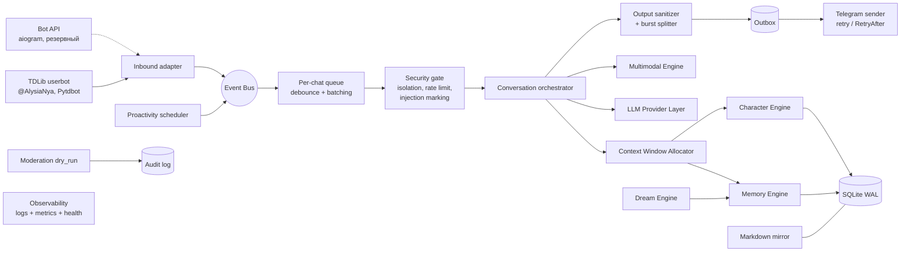

# Архитектура Alya v3

Статус: **предложение (Phase 0)**, требует подтверждения. Дата: 2026-11-08.

## 1. Принципы

1. **Надёжное ядро раньше возможностей.** Приложение обязано работать без FAISS/sqlite-vec и без мультимодальных провайдеров. Транспорт Telegram заменяем: TDLib userbot — основной, Bot API — резервный (это сохраняет критерий приёмки «работает без TDLib»).
2. **Изоляция по умолчанию.** Любое чтение памяти требует явного scope (пользователь + чат). Запроса «без scope» в репозитории нет.
3. **Данные — не инструкции.** Сообщения, память, медиа, ответы инструментов и веб-результаты никогда не повышают привилегии и не меняют базовый характер.
4. **Полномочия — только по проверенному Telegram ID**, а не по имени, нику, пересылке или тексту (принцип из alya-v2).
5. **БД — источник истины**, Markdown — читаемое зеркало (ADR-0004).
6. **Без скрытого chain-of-thought.** Внутренний этап — краткий структурированный план, пригодный для логов.
7. **Каждый внешний провайдер деклярирует capabilities** и может отказать без падения приложения.

## 2. Компоненты



| Компонент | Ответственность | Зависит от |
|---|---|---|
| core | DI-контейнер, Event Bus, lifecycle, конфигурация, ошибки | — |
| storage | SQLite WAL, миграции, outbox, backup/restore, репозитории со scope | core |
| telegram | TDLib userbot-адаптер (основной), Bot API адаптер (резервный и для тестов), очереди, debounce, typing, burst, FloodWait | core, storage |
| security | изоляция, rate limits, circuit breaker, маркировка недоверенного ввода, output sanitizer, privacy-команды | core, storage |
| memory | working / short-term / long-term, FTS5, эмбеддинги, NumPy cosine, RRF, Forget API | storage, llm (эмбеддинги) |
| character | личность, VAD-эмоции, decay, emotional diary, отношения, двухэтапная генерация | memory, llm |
| dream | консолидация, дедупликация, противоречия, confidence/provenance | memory, llm |
| llm | только облачные API: OpenAI / OpenRouter / Anthropic / Gemini / любой OpenAI-compatible; capabilities, ретраи, бюджет токенов. Локальные модели не разворачиваются (решение пользователя) | core |
| multimodal | vision, STT, TTS, стикеры/реакции — всё отключаемо | llm |
| moderation | анализ нарушений в dry_run, audit log, действия только после подтверждения | security, storage |
| observability | структурные логи без PII, метрики, healthcheck, диагностика | core |
| plugins | плагины с декларацией разрешений | core, security |
| api | локальный admin/health HTTP API (минимальный) | core |

## 3. Структура каталогов

```text
alya-v3/
├── src/alya/
│   ├── core/          # container, event bus, lifecycle, config, errors
│   ├── storage/       # db, migrations/, repositories, outbox, backup
│   ├── telegram/      # tdlib/ (основной), bot_api/ (резервный), queue, debounce, sender
│   ├── security/      # isolation, rate_limit, circuit_breaker, sanitizer, privacy
│   ├── memory/        # working, short_term, long_term, search (fts, vector, rrf), forget, mirror
│   ├── character/     # persona, emotion (vad, decay, diary), relationships, planner, responder
│   ├── dream/         # consolidation, dedup, contradictions, scheduler
│   ├── llm/           # base (capabilities), providers/, embeddings, tokenizer, budget
│   ├── multimodal/    # vision, stt, tts, stickers
│   ├── moderation/    # rules, dry_run, audit
│   ├── observability/ # logging, metrics, health, diagnostics
│   ├── plugins/       # registry, permissions
│   ├── api/           # admin/health http
│   └── setup/         # setup wizard
├── migrations/        # SQL-миграции с номерами
├── character/         # канонические файлы персонажа (из alya-v2, после согласования)
├── tests/             # unit/, integration/, security/
├── docs/              # SPEC_V3, ARCHITECTURE, ADR/, ...
├── docker/            # Dockerfile, compose.yaml, entrypoint
├── scripts/
├── config.example.toml
├── .env.example
└── pyproject.toml
```

Отличие от структуры в спецификации: пакет вложен в `src/alya/` (src-layout, чтобы тесты не импортировали код из рабочей директории) и добавлен `setup/` для Setup Wizard. Если пользователь против — вернуться к плоскому `src/`.

## 4. Поток входящего сообщения

1. **Inbound adapter** получает update, нормализует в `InboundMessage` (chat_id, user_id, message_id, текст, медиа-метаданные, reply_to, признак упоминания). Внутренний формат Telegram в модель не попадает.
2. **Event Bus** публикует `message.received`; сообщение сразу пишется в `messages`.
3. **Per-chat queue**: строгий порядок внутри чата, параллельность между чатами. Debounce (настраиваемо, порядок 1–3 с) склеивает быстрые сообщения в одну пачку.
4. **Security gate**: allow-list/lockdown, rate limit на пользователя и чат, в группах — **Addressee Detector** решает, обращено ли сообщение к Але: явные сигналы (reply, @упоминание, имя) или продолжение её разговора без reply (см. раздел 4.1 и ADR-0008); маркировка недоверенного содержимого.
5. **Orchestrator**: typing presence → сбор контекста (Allocator) → этап 1 «план» (JSON: intent, tone, memories_used, actions, constraints) → этап 2 «ответ».
6. **Output sanitizer**: удаление системных маркеров, утечек промпта/секретов, некорректной разметки; валидация под Telegram HTML.
7. **Burst splitter**: до N частей (по умолчанию 3, ~160 символов, как в alya-v2), задержки ограничены.
8. **Outbox → Sender**: отправка с ретраями и уважением RetryAfter; идемпотентность по outbox id.
9. После отправки: обновление эмоций (VAD + причина), working memory, запись событий; извлечение фактов — асинхронно, не блокирует ответ.

### 4.1. Addressee Detector (группы)

Цель: Аля понимает, что ей ответили, даже без reply. Пример: Аля написала «хорошо, а ты как?», человек ответил «да норм, устал» обычным сообщением — это ответ ей.

1. **Явные сигналы → отвечать:** reply на сообщение Али, @упоминание, обращение по имени и его формам (настраиваемый список: Аля, Алька, Алечка…).
2. **Явные анти-сигналы → не отвечать:** reply другому человеку, @упоминание другого, обращение к другому по имени.
3. **Активные нити разговора:** после каждого сообщения Али в чате открывается нить «Аля ↔ адресат(ы)» с TTL (по умолчанию несколько минут, продлевается при обмене). Если Аля задала вопрос — вес выше.
4. **Оценка:** признаки складываются в score: автор — адресат открытой нити, прошло мало времени, между сообщениями мало чужих реплик, сообщение похоже на ответ (короткое, местоимения «ты/тебе», ответ на вопрос), нет анти-сигналов.
5. **Пороги:** высокий score → отвечать; низкий → молчать; серая зона → дешёвый LLM-классификатор с последними N сообщениями чата и вопросом «кому адресовано: Але / другому / всем / непонятно». Классификатор возвращает только метку и уверенность.
6. **Ограничители:** лимит ответов в минуту на чат, cooldown, «молчать при сомнении» по умолчанию; решение и признаки пишутся в диагностический лог (без текста сообщений).
7. **Тесты:** набор сценариев — ответ без reply, ответ другому сразу после Али, двое говорят одновременно, нить истекла, вопрос «всем».

## 5. Модель данных (черновик)

| Таблица | Назначение | Ключевые поля |
|---|---|---|
| users | Telegram-пользователи | tg_user_id (PK), display_name, role (owner/admin/user), timezone, created_at |
| conversation_threads | Активные нити разговора в группах | id, chat_id, participant_user_ids, last_alya_message_id, opened_at, expires_at, expects_answer |
| chats | Чаты | tg_chat_id (PK), type (private/group/supergroup), title, settings_json, proactive_enabled |
| chat_members | Связь пользователь–чат | chat_id, user_id, first_seen, last_seen |
| messages | История (с TTL) | id, chat_id, user_id, tg_message_id, direction, text, media_ref, created_at, expires_at |
| memories | Воспоминания всех уровней | id (ULID), owner_user_id, chat_id, scope (private / chat / character), layer (working/short/long), category, content, provenance_json, confidence, created_at, updated_at, expires_at, is_permanent, superseded_by |
| memories_fts | FTS5 (external content) | rowid ↔ memories, content |
| memory_embeddings | Векторы | memory_id, model_id, dim, vector BLOB (float32), created_at |
| memory_links | Связи | from_id, to_id, relation (supports/contradicts/derived_from/about) |
| relationships | Отношение персонажа к пользователю в чате | user_id, chat_id, affinity, trust, notes, updated_at |
| emotional_state | Текущее VAD | scope_key, valence, arousal, dominance, label, intensity, updated_at |
| emotional_diary | История изменений | id, scope_key, delta_vad, cause, message_id, created_at |
| tasks | Обещания / напоминания | id, user_id, chat_id, text, due_at, status, source_message_id |
| events | Журнал доменных событий | id, type, payload_json (без PII где возможно), created_at |
| outbox | Исходящие действия | id, chat_id, kind, payload_json, status, attempts, next_attempt_at |
| audit_log | Модерация и админ-действия | id, actor, action, target, reason, dry_run, created_at |
| schema_migrations | Версии схемы | version, applied_at, checksum |

**Правило scope:** private-воспоминание видно только в паре (owner_user_id, этот же приватный чат); chat-воспоминание — только в этом чате и только как групповой контекст; character-память — общие факты о самой Але без данных пользователей. Межчатовая связь пользователя хранит только факт встречаемости (как в alya-v2), не текст.

## 6. Поиск памяти

- **Полнотекстовый:** SQLite FTS5. Пользовательский текст никогда не передаётся как FTS-синтаксис: токены экранируются и берутся в кавычки (идея из alya-v2 `daily_memory.cpp`).
- **Семантический (обязательный fallback):** эмбеддинги float32 в BLOB, загрузка кандидатов только в рамках scope, косинус на NumPy. При малом числе записей на scope (ожидаемо — сотни/тысячи) полный перебор приемлем; это нужно подтвердить бенчмарком в Phase 2.
- **Ускорители (опционально):** sqlite-vec, FAISS — включаются флагом, результаты сверяются с NumPy в тестах.
- **Слияние:** Reciprocal Rank Fusion, score = Σ 1/(k + rank), k = 60 по умолчанию, плюс модификаторы confidence, свежести и usage.
- Если эмбеддинг-провайдер недоступен — только FTS5, с пометкой в диагностике.

## 7. Context Window Allocator

Бюджет = окно модели − резерв на ответ. Слои по приоритету (вырезаются снизу):

| P | Слой | Политика |
|---|---|---|
| 0 | Ядро персонажа + политика безопасности | всегда, фиксированный размер |
| 1 | Проверенный контекст автора (роль, ID) | всегда |
| 2 | Текущая пачка сообщений | всегда, обрезка самых длинных |
| 3 | Последние сообщения диалога | от новых к старым |
| 4 | Working memory + задачи | лимит токенов |
| 5 | Эмоции и отношения | компактная сводка |
| 6 | Long-term (результаты RRF) | top-k в пределах бюджета |
| 7 | Short-term сводки | остаток |

Подсчёт токенов: токенизатор провайдера, если доступен; иначе консервативная оценка по символам. Какие провайдеры дают локальный токенизатор — **не проверено**, это задача Phase 1.

## 8. Dream Engine

Фоновая задача (по расписанию и по порогу объёма), не блокирующая ответы: кластеризация похожих записей (порог настраиваемый; у Kuni — 0.97 «плагиат» и 0.80 «связанность», как стартовые значения), слияние с сохранением provenance, обнаружение противоречий через memory_links, понижение confidence устаревших фактов. Записи с максимальным confidence (подтверждённые пользователем) не изменяются автоматически — идея из Kuni. Все изменения в одной транзакции; исходники хранятся до успешного завершения (идея из alya-v2).

## 9. Хранение, миграции, backup, удаление

- SQLite в режиме WAL, `busy_timeout`, внешние ключи включены, одна пишущая задача на соединение.
- Миграции — нумерованные SQL-файлы с checksum, применяются при старте, только вперёд; откат — через restore из бэкапа.
- Backup — онлайн-бэкап SQLite (`VACUUM INTO` или backup API) + архив Markdown-зеркала; restore проверяется тестом.
- Forget API: удаление по пользователю / чату / записи из memories, FTS, эмбеддингов, ссылок, сводок, зеркала, сообщений и бэкап-политики (бэкапы с истечением срока; что делать с уже сделанными бэкапами — вопрос пользователю).

## 10. Развёртывание

Docker, non-root пользователь, read-only rootfs где возможно, данные в volume. Целевой хост — Ubuntu + Docker Compose (версия Ubuntu и архитектура CPU уточняются). TDLib в образе **не собирается**: используется prebuilt libtdjson из пакета tdjson. Каталог сессии TDLib — отдельный volume, доступный только пользователю контейнера; первичная авторизация (код, 2FA) — интерактивной командой setup. Локальных моделей нет: LLM, эмбеддинги, vision, STT и TTS — через API.

## 11. Возможности (паритет с Kuni)

Все возможности — инструменты (tools) с типизированными аргументами, проверкой роли и чата, лимитами и выключателем в конфиге. Модель вызывает их через tool calling; деструктивные и «публичные» действия требуют подтверждения владельца.

| Возможность | Источник идеи | Реализация | Ограничения |
|---|---|---|---|
| Веб-поиск | Kuni web_search | поисковый API (провайдер — выбрать в Phase 6/7) | результаты помечены как недоверенные данные |
| Vision | Kuni vision | роль vision через API | лимит размера |
| Голосовые: распознавание | Kuni hearing | роль stt (OpenRouter /audio/transcriptions) | лимит длительности |
| Голосовые: ответ голосом | Kuni record_voice | роль tts (OpenRouter /audio/speech), отправка voice note | лимит частоты |
| Стикеры | Kuni stickers | выбор из разрешённых наборов по описанию/эмоции | — |
| Реакции | alya-v2 | TDLib setMessageReactions (имя метода сверить в Phase 4) | лимит частоты |
| Фото «себя» | Kuni take_photo | роль image через API, с описанием внешности из character/ | по запросу, лимит |
| Вступление в чат по ссылке | alya-v2 | только по команде владельца | без массовых вступлений (ToS) |
| Bio и аватар | alya-v2 | только по команде владельца или с его подтверждением | — |
| Чтение каналов | новое | подписки из списка владельца, сводки в память персонажа | контент каналов — недоверенные данные |
| Напоминания | Kuni/alya-v2 | tasks + планировщик | тихие часы |

Proxy-сервер Kuni (подмешивание контекста в чужой /v1/chat/completions) в MVP не входит.
